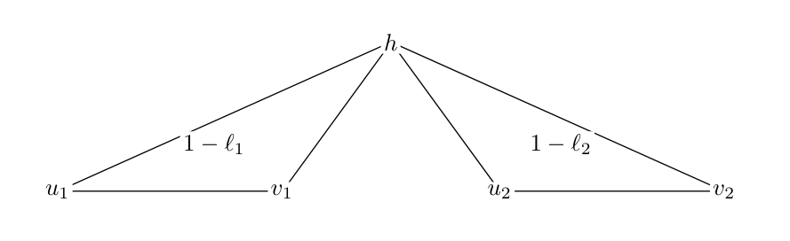
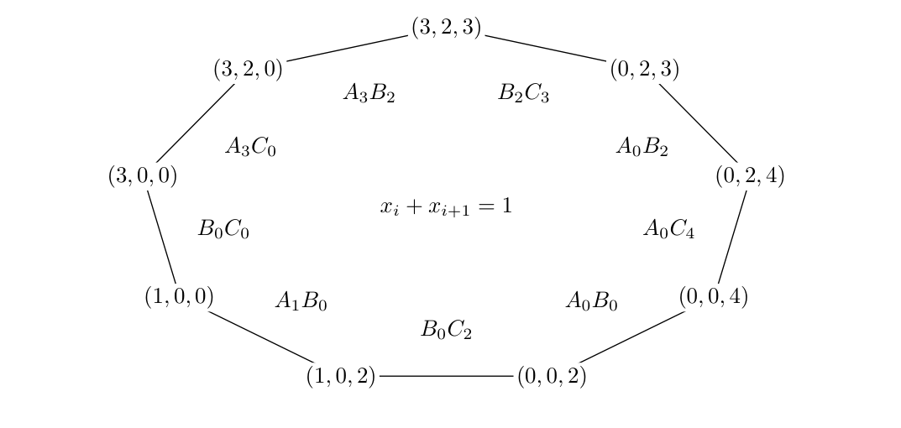
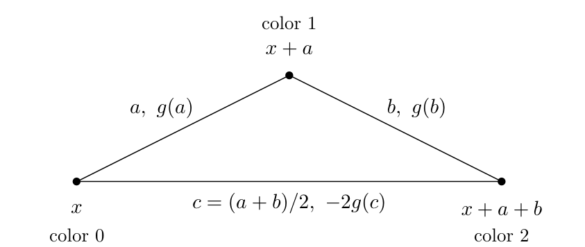

# Nearly Quadratic Additive Gaps for Edge-Clique Partitions of Split Graphs

**Juan Pablo Traverso Gianini** 
Independent researcher, Santiago, Chile 
[jtraverso@gmail.com](mailto:jtraverso@gmail.com) 
[ORCID: 0009-0003-6068-4096](https://orcid.org/0009-0003-6068-4096)

*Preprint 1.0 · November 21, 2026* · [PDF](split-gap-en.pdf) · [Lean companion](../05_formalization/companion-en.md)

**Reserved DOI:** 10.5281/zenodo.24408988 
**Official repository:** <https://github.com/jtraverso/split-clique-partition-gap>

## Abstract

Motivated by our work on Erdős Problem 81, we ask how much a minimum clique partition of a chordal graph can gain from fractional weights. Even on split graphs, the gain can be nearly quadratic. For every sufficiently large $n$, we construct a connected split graph on exactly $n$ vertices whose additive gap is at least

$$
k\,n^2(\log n)^{-5/2}\exp\!\left[-2\sqrt{\log(24/7)\log n}\right]
$$

for an absolute constant $k>0$. The same graph can be chosen with vertex connectivity at least $\lceil n/5\rceil$. The construction places edge-disjoint copies of a fifteen-vertex tripartite graph on affine blocks. Each copy admits a fractional triangle decomposition but no integral one. An integral packing can use triangles with edges in three different blocks, and the midpoint potential of Elsholtz, Hunter, Proske, and Sauermann gives signed edge weights whose sum is positive on every such triangle. With the host assignments developed in the Erdős 81 series, we turn the resulting deficit in the residual packing problem into a gap between the two clique partition numbers.

## 1. Introduction

In a clique partition of a finite simple graph $G$, each edge belongs to exactly one of the chosen cliques. Write $cp(G)$ for the smallest number of cliques in such a partition. Its fractional counterpart $cp^*(G)$ is the minimum total weight of a nonnegative weighting of the cliques in which the weights at each edge sum to one. Throughout, cliques used as pieces have at least two vertices, and logarithms are natural.

A graph is chordal if it has no induced cycle of length four or more. A split graph admits a partition of its vertices into a clique and an independent set, and is therefore chordal. Erdős, Ordman, and Zalcstein studied the largest integral partition number of a chordal graph [8], and Chen, Erdős, and Ordman treated split graphs [9]. A recent preprint of Okechukwu determines the chordal extremum at all sufficiently large orders [10].

The question here grew out of our series on Erdős Problem 81. Paper I reduced fractional triangle packing in split graphs to a linear program in three variables [14]. Paper II found that a complete-split graph attains the maximum of the fractional triangle-cover deficit over chordal graphs [15]. On the integral side, Paper III used triangle packings to construct split-graph partitions with $cp(G)\le n^2/6+O(n)$ [1]. Those results led us to compare the two optima on the *same* chordal graph. Their difference, $\Delta(G)=cp(G)-cp^*(G)$, measures a loss that separate extremal values do not determine. We return to split graphs because Paper III posed a specific rounding question there [1, Problem 12.1], and the host assignments of Paper V [5, §5] let us realize an obstruction to rounding as a clique partition gap.

For edge-disjoint packings, Haxell and Rödl proved that rounding a fractional packing of copies of a fixed graph costs $o(n^2)$ [7]. Yuster extended this to a fixed family of graphs and asked how large the loss could be for triangles [6, §4]. For triangle packings, which may leave edges uncovered, Balogh, He, Krueger, Nguyen, and Wigal constructed graphs with gap $n^{2-o(1)}$ [2, Theorem 5.8]. For exact partitions into cliques of arbitrary order, their rounding theorem with unit costs gives $\Delta(G)=o(n^2)$ uniformly over all graphs on $n$ vertices [2, Theorem 1.10].

A nearly quadratic gap for exact partitions on unrestricted graphs also follows from their cover construction [2, Proposition 5.3 and Theorem 5.5]. In a cocktail-party graph with $r$ parts of size two, assigning weight $4/2^r$ to each transversal gives every edge load one. The fractional partition thus costs at most four, while every integral partition is a cover. In the amplification by a linear, triangle-free hypergraph [11, 12], each clique with an edge belongs to a unique block, so the local gaps add. The restriction to connected split graphs requires a different way to handle triangles that cross blocks.

#### Theorem 1.1

There are absolute constants $k>0$ and $N$ such that for every integer $n\ge N$ there is a connected split graph $G$ on exactly $n$ vertices with

$$
\Delta(G)\ge k\,\frac{n^2}{(\log n)^{5/2}}\,\exp[-C\sqrt{\log n}],
\qquad C=2\sqrt{\log(24/7)}.
$$

#### Corollary 1.2

For each $\eta>0$ and all sufficiently large $n$, there is a connected split graph on $n$ vertices with $\Delta(G)\ge n^2\exp[-(C+\eta)\sqrt{\log n}]$. Indeed, $(5/2)\log\log n-\log k=o(\sqrt{\log n})$, so the extra $\eta\sqrt{\log n}$ absorbs the logarithmic prefactor.

Let $\Gamma(n)$ be the largest gap among connected split graphs of order $n$. Theorem 1.1 and the uniform upper bound imply both $\log\Gamma(n)/\log n\to2$ and $\Gamma(n)/n^2\to0$. Thus $\Gamma(n)$ is not $O(n^{2-\varepsilon})$ for any fixed $\varepsilon>0$. On the same graphs the triangle packing gap is at least $\Delta(G)/2$ (Corollary 7.1), ruling out the proposed linear bound in [1, Problem 12.1].

#### Corollary 1.3 (the chordal extremum)

Let $\Gamma_{\rm ch}(n)$ be the maximum of $\Delta(G)$ over all chordal graphs of order $n$. Then
$$
\lim_{n\to\infty}\frac{\log\Gamma_{\rm ch}(n)}{\log n}=2,\qquad
\lim_{n\to\infty}\frac{\Gamma_{\rm ch}(n)}{n^2}=0.
$$
Every split graph is chordal, so the lower bound in Theorem 1.1 applies to $\Gamma_{\rm ch}(n)$. Its logarithm is $2\log n-O(\sqrt{\log n}+\log\log n)$. The uniform estimate $\Delta(G)=o(n^2)$ from [2, Theorem 1.10] with unit costs gives the second limit and bounds the limsup in the first by two.

#### Theorem 1.4 (connectivity on the same witness)

The witness in Theorem 1.1 can be chosen with vertex connectivity $\kappa(G)\ge\lceil n/5\rceil$. The construction gives at least $\lceil n/5\rceil$ vertices adjacent to every other vertex.

The local obstruction in Section 3 loses its force if an integral packing can use edges from different copies to complete a triangle. In our construction such a triangle has edge directions $a,b,(a+b)/2$. The planar support of Elsholtz, Hunter, Proske, and Sauermann [4] allows these triples and supplies a potential with a positive defect on each nonconstant one. Assigning signed weights to the edges turns that defect into a bound on the number of mixed triangles. A host assignment, in the sense of [5, §5], then converts the packing loss into a gap on a split graph. The coefficient $C$ reflects the limiting density $7/24$ of this planar construction. Its optimality among split graphs remains open.

## 2. An exact transfer to split graphs

Let $B$ be a graph on a finite set $V$, and put $J=\binom V2\setminus E(B)$. For a set $Q\subseteq V$ of size at least two, let $e_B(Q)$ count its $B$-edges and put

$$
w(Q)=2e_B(Q)-\binom{|Q|}{2}-1.
$$

A residual packing is a collection of such sets, no two of which contain the same pair of vertices. A fractional residual packing gives the sets nonnegative weights with total weight at most one on each pair. Denote the maximum total score and maximum weighted score by $I(B)$ and $F(B)$, respectively.

#### Lemma 2.1

Suppose that there is a family $(N_h)_{h\in H}$ of independent sets in $B$, and that every pair of $J$ can be assigned to an index $h$ with both endpoints in $N_h$. Suppose further that the pairs assigned to each $h$ form a matching. Let $G$ be the split graph with clique $V$ and independent set $H$ in which each vertex $h$, called a host, has neighborhood $N_h$. Then $\Delta(G)=F(B)-I(B)$.

**Proof.** Relative to the partition into individual edges, a clique of order $r$ saves $\binom r2-1$ pieces. For a fractional partition the same formula applies after multiplication by the clique weight, since the total load on every edge is one. Only the cliques contained in $V$ enter the residual packing. Each such clique $Q$ saves $w(Q)+2|J\cap\binom Q2|$.

A clique containing a host and $u\ge1$ core vertices saves $\binom{u+1}2-1\le2\binom u2$. Its core pairs all lie in $J$ because $N_h$ is independent in $B$. Across both kinds of cliques, each pair in $J$ has total load one. The residual scores thus contribute at most $I(B)$ in an integral partition and $F(B)$ in a fractional partition, with at most $2|J|$ in additional savings in either case.

Conversely, an optimal residual packing leaves some capacity on the pairs in $J$. For each such pair, its assigned host supplies a triangle that fills the unused capacity and saves twice that amount. Two distinct pairs assigned to the same host have disjoint endpoints, so these triangles respect both incident host-edge capacities. Single edges fill all remaining capacities. The maximum savings are therefore $I(B)+2|J|$ and $F(B)+2|J|$, respectively, and their difference is $\Delta(G)$.

*Figure 1. Two pairs in one host fiber. A pair of residual load $\ell_i$ receives repair weight $1-\ell_i$. Distinct pairs use disjoint edges at $h$. In the midpoint construction of Section 5, position $y$ is paired with $2c-y$.*

## 3. A tripartite obstruction

Label the vertices in each part of $K_{5,5,5}$ by $0,\ldots,4$. Delete the edges of the seven triangles

$$
(2,2,2),(1,2,1),(3,1,4),(0,3,1),(0,4,0),(2,3,0),(4,0,3).
$$

Their edge sets are disjoint. The graph $H$ that remains has 18 edges between each pair of parts. It admits a fractional triangle decomposition, yet no integral one.

In the following table the row and column give the roles in the first two parts, and each entry lists the possible third roles in the fractional decomposition. Every surviving edge occurs in exactly two of the listed triples, so giving each triple weight $1/2$ covers every edge to weight one.

|  | 0 | 1 | 2 | 3 | 4 |
|---|---|---|---|---|---|
| 0 | 2, 4 | 2, 3 | 3, 4 | — | — |
| 1 | 0, 2 | 0, 2 | — | 3, 4 | 3, 4 |
| 2 | 1, 4 | 1, 3 | — | — | 3, 4 |
| 3 | 0, 1 | — | 0, 3 | 2, 3 | 1, 2 |
| 4 | — | 0, 1 | 0, 4 | 2, 4 | 1, 2 |

To restrict the triangles available to an integral decomposition, we assign each edge the integer price in Appendix A. The price of a triangle is the sum of its three edge prices, and the edge prices sum to zero over $H$. Of the $5^3=125$ triples of roles, exactly 45 survive as triangles in $H$. The 36 displayed in the fractional table have price sum zero and the other nine have positive price. Hence an integral decomposition can use only the displayed triangles. In the cyclic list

$$
(3,2,3),(0,2,3),(0,2,4),(0,0,4),(0,0,2),
(1,0,2),(1,0,0),(3,0,0),(3,2,0)
$$

each consecutive pair shares an edge, including the last and first. Exactly two displayed triangles use each of those edges. The selection indicators of consecutive triangles must therefore sum to one. This parity argument is familiar from the support graphs of tristochastic arrays [3]. The odd cycle forces each indicator to be $1/2$, which is impossible for an integral decomposition.

*Figure 2. The nine triangles in the parity obstruction. The link labels identify shared edges, with $A_i,B_j,C_k$ denoting vertices in the three parts. After the edge prices exclude the nine positive-price triangles, each link forces the two incident indicators to sum to one.*

Equivalently, the seven deleted triples prescribe entries of a partial Latin square of order five. A triangle on row $i$, column $j$, and symbol $k$ fills the corresponding entry. Decomposing the remaining edges would complete the square, whereas the half-weight table supplies a fractional completion.

## 4. The residual gap

Let $T$ be a finite abelian group of odd order and let $\varnothing\ne A\subseteq T$. A core vertex $(t,r,y)$ has a color $t\in\{0,1,2\}$ specifying the part, a role $r\in\{0,\ldots,4\}$ within that part, and a position $y\in T$. Each $(a,x)\in A\times T$ indexes a block, the copy of $H$ on the vertices $(t,r,x+ta)$. Let $B$ be the union of their edges and put $\tau=|A||T|$. For an edge from color $s$ at position $y_s$ to color $t>s$ at $y_t$, the direction is $a=(y_t-y_s)/(t-s)$ and the intercept is $x=y_s-sa$. Division by two is unique in a group of odd order. Every edge of $B$ therefore belongs to exactly one block, giving $54\tau$ edges in all.

For $v=|Q|$ and $e=e_B(Q)$, the tripartite bound is $e\le\lfloor v^2/3\rfloor$. Define

$$
s(Q)=\tfrac23 e-w(Q)=\binom v2+1-\tfrac43e.
$$

Then $s(Q)\ge0$, with equality exactly for $B$-triangles and complete tripartite subgraphs with two vertices in each part. For $2\le v\le8$, the successive maximum values of $e$ are $1,3,5,8,12,16,21$. At $v=3,6$, equality requires the maximum. In the other cases, and at the next integer below the maximum when $v=3,6$, substitution gives $s(Q)\ge e/27$. Smaller $e$ only increases $s(Q)-e/27$. For $v\ge9$,

$$
s(Q)-e/27\ge \frac{(v-9)(7v-18)}{162}\ge0.
$$

Here $s(Q)\ge e/27$, so zero slack would imply $e=0$ and hence $s(Q)=\binom v2+1>0$. A complete $K_{2,2,2}$ partitions into four triangles, obtained by labeling the two vertices in each part with bits and taking the triples of even parity.

The bound $w(Q)\le 2e_B(Q)/3$ gives $F(B)\le36\tau$. For the reverse inequality, the local fractional decompositions can be combined because their blocks share no edges and each triangle uses only block edges. Each block contributes 36 triangles of weight $1/2$ and score two, giving $F(B)=36\tau$.

A triangle meeting several blocks has successive position increments $a,b$ and long-edge direction $c=(a+b)/2$, as in Figure 3. Its three edges have distinct owners whenever $a\ne b$. The following estimate assigns a cost to each such triangle.

*Figure 3. Directions and signed weights. When $a=b$, all edges lie in one block and their weights sum to zero. When $a\ne b$, the edges belong to three blocks and the midpoint defect gives total weight at least $\delta$.*

#### Lemma 4.1

Suppose $f:A\to\mathbb R$ has range $R=\max f-\min f$ and

$$
 f(a)+f(b)-2f((a+b)/2)\ge\delta>0
$$

whenever $a\ne b$ and $a,b,(a+b)/2\in A$. Then

$$
 F(B)-I(B)\ge \frac{2\tau}{9(1+2R/\delta)}.
$$

**Proof.** Let $\mathcal P$ be an integral packing of score $F(B)-d$, and let $U$ be the set of $B$-edges it leaves uncovered. Each covered edge lies in exactly one piece. Since $F(B)=\tfrac23|E(B)|$, summing the definition of slack gives

$$
d=\tfrac23|U|+\sum_{Q\in\mathcal P}s(Q).
$$

Let $X$ consist of $U$ and the $B$-edges in pieces of positive slack. Each such piece contains at most $27s(Q)$ edges of $B$, so $|X|\le27d$. The remaining edges are partitioned into triangles by splitting each tight $K_{2,2,2}$ as above.

Write $g=f-(\min f+2\max f)/3$. An edge of direction $a$ receives weight $g(a)$ between colors 0 and 1 or 1 and 2, and weight $-2g(a)$ between colors 0 and 2. Each block has 18 edges of each type, all of the same direction, so its total weight is zero. Since $-2R/3\le g\le R/3$, every edge has weight at least $-2R/3$. On a triangle the weights sum to $g(a)+g(b)-2g((a+b)/2)$. This vanishes inside one block and is at least $\delta$ on a mixed triangle. The triangles partition $E(B)\setminus X$, so if $z$ of them are mixed, their contribution is bounded by the negative of the total weight on $X$. In particular, $\delta z\le(2R/3)|X|$.

The vertices of $K_{5,5,5}$ have even degree, and deleting a triangle removes two edges at each of its vertices. A packing of 17 triangles in $H$ would therefore leave three edges with even degree at every vertex. In a simple graph those three edges must form a triangle, which would complete the forbidden decomposition of $H$. Thus at most 16 triangles of the packing can lie wholly in any one block. Appendix A gives 16 disjoint triangles attaining this bound.

Each edge has a unique owner. In each block at least $54-3\cdot16=6$ edges therefore belong to $X$ or to a mixed triangle. Summing over blocks gives $6\tau\le |X|+3z$. Together with $\delta z\le (2R/3)|X|$ and $|X|\le27d$, this gives $6\tau\le27(1+2R/\delta)d$. Taking an optimal integral packing gives the stated bound.

## 5. Host count and exact order

Suppose $T\setminus A$ is partitioned into $s$ nonempty classes $U$, each satisfying $(U+U)/2\subseteq T\setminus A$. A role-pair type records the unordered pair of color-role labels $(t,r)$, allowing repetition. Of the 66 types that are never edges of $H$, 15 repeat a label, $3\binom52=30$ pair different roles of one color, and 21 are the cross-color edges deleted in Section 3. For each such type and each $c\in T$, add a host whose neighborhood comprises the full role or pair of roles. Assign pairs to hosts by their type and midpoint $c$. The neighborhoods are independent in $B$. Once one endpoint position $y$ is fixed, its partner in a fiber of midpoint $c$ has position $2c-y$, so the fiber is a matching.

For each of the 54 role-pair types that is an edge of $H$, order the colors as $i<k$ and put $d=k-i\in\{1,2\}$. For each class $U$ and each $c\in T$, add a host with positions $c-du/2$ in color $i$ and $c+du/2$ in color $k$, for $u\in U$. Two vertices in opposite roles of this neighborhood have direction $(u+u')/2\notin A$, and within a role there are no $B$-edges. Each pair of this type outside $B$ is assigned using its midpoint and the class of its direction. The midpoint again determines a partner given either endpoint. These hosts satisfy Lemma 2.1. Their neighborhoods are nonempty, so the resulting graph is connected, and its total order is

$$
(81+54s)|T|.
$$

We can enlarge each host neighborhood while retaining the pair assignment. For any two role labels $i,k$ there is a role $s$ adjacent to neither in $H$. When $i$ and $k$ have the same color, any role of that color works. Otherwise, some role in the color of $i$ lost its edge to $k$, since $k$ occurs in at least one of the seven deleted triples of Section 3. We add all $t=|T|$ vertices of role $s$ to the neighborhood of each host of type $\{i,k\}$. This union is independent in $B$. The pairs assigned to the host still form the same matching, so Lemma 2.1 preserves both optimal savings.

To reach a prescribed larger order, we add hosts whose neighbors are the $t$ vertices of a single role. The existing hosts retain all pair assignments. Each new host adds $t$ edges and leaves both optimal savings fixed. Hence $q$ such hosts increase $cp$ and $cp^*$ by exactly $qt$. Every host now has at least $t$ neighbors in a clique of order $15t$. Deleting fewer than $t$ vertices leaves a nonempty clique and a neighbor in that clique for each surviving host. Thus $\kappa(G)\ge t$. When a padding host is present, deleting its $t$ neighbors isolates it, giving equality.

#### Proposition 5.1 (transfer from a set of directions)

Under the hypotheses of Lemma 4.1, let $\sigma(A)$ be the minimum number of nonempty classes partitioning $T\setminus A$ such that $(U+U)/2\subseteq T\setminus A$ in every class. Use zero classes for the empty complement. There exists a split graph $G$ with $\kappa(G)\ge|T|$ satisfying

$$
|V(G)|=(81+54\sigma(A))|T|,\qquad
\Delta(G)\ge\frac{2|A||T|}{9(1+2R/\delta)}.
$$

Indeed, singletons give an admissible partition, so the minimum is attained. The host construction above applied to a minimizing partition gives the exact order. Lemma 2.1 identifies the gap with $F(B)-I(B)$, to which Lemma 4.1 applies. Thus a choice of directions enters the bound through its size, the number of complement classes, and the potential ratio $R/\delta$.

#### Adding universal vertices

The residual graph $B$ is tripartite. Let $V$ denote its vertex set and $V_0,V_1,V_2$ its color classes. Add a set $W$ of $x>0$ isolated vertices to $B$, obtaining $B'$. For a piece $Q\subseteq V\cup W$, put $S=Q\cap V$ and $r=|Q\cap W|$. Its score satisfies

$$
w_{B'}(Q)=w_B(S)-r|S|-\binom r2
$$

when $|S|\ge2$. A piece with $|S|<2$ has negative score. Dropping such pieces and projecting the others onto $V$ preserves all pair capacities. Two retained pieces in an integral packing cannot have the same projection, since they would share a pair. In a fractional packing we add the weights of any coinciding projections. The projected score is at least the original score, and the old packings lift to $B'$ with the same score. Thus $I(B')=I(B)$ and $F(B')=F(B)$.

In the split graph, enlarge the core to $V\cup W$ and include $W$ in every old host neighborhood. The old assignment of pairs in $V$ still works. Label the enlarged core by a bijection $\ell:V\cup W\to\mathbb Z/(|V|+x)\mathbb Z$. For each $i\in\{0,1,2\}$ use $|V|+x$ hosts with neighborhood $W\cup V_i$, one for each label sum. Assign a pair from $W\times V_i$ by the sum of its two labels. Assign pairs inside $W$ by the same rule in the host family for $i=0$. Since $\ell$ is injective on $V\cup W$, a fixed endpoint and the sum determine the other endpoint even in family $i=0$, where both kinds of pairs occur. Thus each fiber is a matching. Independence of the new neighborhoods in $B'$ follows from the choice of $V_i$ and the isolation of $W$.

Any further hosts needed to reach the prescribed order have neighborhood $W$ and receive no assigned pairs. Lemma 2.1 gives the same gap after enlargement and padding. Each vertex in $W$ is adjacent to every other vertex of the split graph. Deleting fewer than $x$ vertices leaves a universal vertex and hence a connected graph.

## 6. Choosing the directions

Fix $0<\epsilon<7/48$. The explicit polygonal construction of [4, Proposition 2.2 and Definition 4.1] gives a set $S\subseteq[0,1)^2$ of area at least $7/24-\epsilon$ and a function $f:S\to[0,100/\epsilon^2]$. For $x,y,z\in S$ with $x+z=2y\bmod1$, it satisfies

$$
f(x)+f(z)-2f(y)\ge\|x-z\|^2.
$$

For an odd integer $m$, take $S_m\subseteq(\mathbb Z/m)^2$ to be the grid points with representatives $u\in\{0,\ldots,m-1\}^2$ such that $u/m\in S$. We shall need the grid error uniformly as the polygon varies.

#### Lemma 6.1 (uniform discretization)

For every $0<\epsilon<7/48$ and every positive odd $m$,

$$
\left|\,|S_m|/m^2-\operatorname{area}(S)\right|\le 33/m.
$$

**Proof.** Partition the unit square into half-open grid squares of side $1/m$, sampling each at its lower left corner. Only squares whose closures meet the boundary can contribute error. The boundary lies on $a=1/2$, $b=1/2$, $2a+b=3/2+\epsilon$, the four lines $a+b\in\{2/3,7/6,7/6+\epsilon,17/12\}$, and the four sides of the square. For a segment of slope at most one in absolute value, its height varies by at most $1/m$ in each of the $m$ closed grid columns. Its projection there meets at most three closed row intervals, including endpoint contacts. Interchanging rows and columns gives the same count for steep or vertical segments. The eleven segments therefore meet at most $33m$ cells altogether, giving an error at most $33/m$.

In particular, $|S_m|\ge\rho m^2$ for all sufficiently large $m$, where $\rho=7/24-2\epsilon$. Scaling the potential to $m^2 f(u/m)$ gives defect at least one on every nontrivial midpoint relation and range at most $100m^2/\epsilon^2$.

Write $z=a+b$ for a point $(a,b)$ in the unit square. The three branches of $S$ are given by (i) $a\ge1/2$ and $2/3<z\le7/6$, (ii) $a\ge1/2$, $b<1/2$ and $7/6+\epsilon\le z\le17/12$, and (iii) $a<1/2$, $7/6+\epsilon\le z\le17/12$ and $2a+b\ge3/2+\epsilon$. In (iii), the lower bound on $z$ implies $b>1/2$. The following six convex sets cover the complement inside the square. Every row, including its stated boundary, is disjoint from $S$.

| Row | Conditions |
|---|---|
| 0 | $z\le 2/3$ |
| 1 | $a<1/2$, $z<7/6+\epsilon$ |
| 2 | $7/6<z<7/6+\epsilon$ |
| 3 | $7/6<z$, $a\ge1/2$, $b\ge1/2$ |
| 4 | $a<1/2$, $2a+b<3/2+\epsilon$ |
| 5 | $z>17/12$ |

To check coverage, take a point avoiding all six rows. Its sum lies in $(2/3,17/12]$. If $z\le7/6$, avoiding row 1 forces $a\ge1/2$, giving the first branch of $S$. Otherwise $z\ge7/6+\epsilon$. If $a\ge1/2$, avoiding row 3 forces $b<1/2$ and the second branch applies. If $a<1/2$, then $z>7/6$ forces $b>1/2$ and avoiding row 4 gives the last inequality of the third branch. Conversely each row violates a necessary condition in each branch of $S$.

Assign an exterior grid point the first applicable row and the parities of its two integer representatives. Equal parities make the ordinary midpoint an integer grid point, which represents the modular midpoint for odd $m$. Although rows may overlap, convexity keeps the midpoint in the selected row and hence outside $S_m$. In the product, record the index of the first failed factor and its row and parity label. Equality of labels forces the midpoint outside $S_m$ in that factor. This gives at most $24j$ classes for $T=(\mathbb Z/m)^{2j}$ and $A=S_m^j$. Summing the potential over the factors gives defect at least one and range at most $100jm^2/\epsilon^2$. The construction of Section 5 before enlargement uses at most $(81+1296j)m^{2j}$ vertices. Let $b_j=255+2880j$ be the larger multiplier used in the formal proof.[^hosts] If $|S_m|\ge\rho m^2$, Lemmas 2.1 and 4.1 give a base graph $G_0$ satisfying

$$
 |V(G_0)|\le b_j m^{2j},\qquad
 \Delta(G_0)\ge\frac{2\rho^j m^{4j}}{9(1+200jm^2/\epsilon^2)}.
$$

[^hosts]: Lean reserves $2+24j$ labels for each of the 120 unordered role pairs with repetition, giving the multiplier $15+120(2+24j)=255+2880j$.

#### Proof of Theorems 1.1 and 1.4

Set $h_j=25b_j$, $\rho_0=7/24$, $c_0=-\log\rho_0$, $L=\log n$, and $j=\lfloor\sqrt{L/c_0}\rfloor$. Use $\epsilon=7/(1080j)$ and the largest odd $m\le X=(n/h_j)^{1/(2j)}$. Since $\log X=(L-O(\log j))/(2j)$, we have $X/j\to\infty$. In particular $m\ge12000j$ eventually, so $33/m\le\epsilon$, and $m>X-2$ gives $(m/X)^{4j}\ge(1-2/X)^{4j}=1-o(1)$.

By Lemma 6.1 and the area bound, $|S_m|/m^2\ge\rho_0-2\epsilon\ge\rho_0(1-2/(3j))$. Bernoulli's inequality gives $(1-2/(3j))^j\ge1/3$, so the product density is at least $\rho_0^j/3$. The range of the product potential is at most $100(1080/7)^2j^3m^2$. The base graph has order $n_0\le b_jm^{2j}\le n/25$. Put $x=\lceil n/5\rceil$ and apply the construction with universal vertices from Section 5. Before padding, the enlarged order is $n_0+x+3(|V|+x)\le4n_0+4x\le n$ for $n\ge100$. Enlargement and padding preserve the gap, so

$$
\Delta(G)\gg\frac{\rho_0^j m^{4j}}{j^3m^2}
 \gg\frac{n^2}{j^5}\exp(-c_0j-L/j).
$$

Here $m^{4j}\gg X^{4j}=n^2/h_j^2$, $m^2\le e^{L/j}$, and $h_j=O(j)$. Two powers of $j$ come from the vertex count and three from the potential. Finally $c_0j+L/j-2\sqrt{c_0L}=c_0(j-\sqrt{L/c_0})^2/j=O(1/j)$ and $j^{-5}\asymp L^{-5/2}$. This proves Theorem 1.1, and the $x$ universal vertices give Theorem 1.4.

The construction gives a deterministic algorithm for listing the edges. Integer comparisons select the largest $j$ satisfying $24^{j^2}\le n7^{j^2}$ and the largest odd $m$ with $h_jm^{2j}\le n$. Rational inequalities determine the support and exterior labels. We can number the core and new vertices in lexicographic order and use the sums of those labels to assign the new pairs. Since $m^{2j}\le n$ and $j=O(\sqrt{\log n})$, constructing the neighborhoods and listing the edges takes polynomial time in $n$.

## 7. Consequences for triangle and mixed packings

Problem 12.1 of [1] asks whether the difference between the fractional and integral triangle packing numbers of split graphs is $O(n)$. The same graphs give a negative answer. Write $\nu_3^*(G)$ and $\nu_3(G)$ for the maximum fractional weight and the maximum number of edge-disjoint triangles, respectively.

#### Corollary 7.1

For each graph obtained in Sections 4–6, including after enlargement by universal vertices and padding,

$$
\nu_3^*(G)-\nu_3(G)\ \ge\ \tfrac12\Delta(G).
$$

Indeed, the fractional optimum in Section 4 uses triangles alone. Its completion in Section 2 uses only triangles and single edges, and any extra host edges can be filled with single edges. A triangle of weight $x$ saves $2x$ relative to using single edges. Since every fractional triangle packing can also be completed with single edges, $cp^*(G)=|E(G)|-2\nu_3^*(G)$ on these graphs. Completing a maximum integral triangle packing gives $cp(G)\le |E(G)|-2\nu_3(G)$, which together with the fractional identity gives $\Delta(G)\le2(\nu_3^*(G)-\nu_3(G))$.

#### Corollary 7.2 (mixed triangle and $K_4$ packings)

On the same graphs, the gap between the fractional and integral mixed packing gains is at least $\Delta(G)$. Write $W_4^*(G)$ and $W_4(G)$ for the optimal fractional and integral gains with weights two for triangles and five for copies of $K_4$, as in [16, §2]. If $c_4$ and $c_4^*$ restrict clique partitions to orders two through four, completing with single edges gives $W_4^*-W_4=c_4-c_4^*$. The fractional optimum above uses only edges and triangles, so $c_4^*(G)=cp^*(G)$. Since $c_4(G)\ge cp(G)$, the claimed inequality follows. In particular, the mixed gain gap has no universal linear bound on chordal graphs, even on the split graphs in Theorem 1.4.

For the original economical host construction, before enlarging neighborhoods or padding, put $t=|T|$ and $\tau=|A|t$. The local fractional triangles have total weight $18\tau$. They use only edges of $B$, leaving every one of the $\binom{15t}{2}-54\tau$ other core pairs for a host triangle of weight one. This gives

$$
\nu_3^*(G)=\binom{15t}{2}-36\tau,\qquad
cp^*(G)=\nu_3^*(G)+15t=\frac{225t^2+15t}{2}-36\tau.
$$

To count the single-edge pieces, observe that for different color-role labels the pairs assigned to a host match every vertex in its neighborhood. For a repeated label the involution $y\mapsto2c-y$ has one fixed point, $y=c$. This leaves one unused host edge for each of the $15t$ repeated-label hosts. All other edges are covered fractionally by triangles. Optimality follows from Lemma 2.1 and the fractional identity in Corollary 7.1.

Theorem 1.4 gives a nearly quadratic gap at vertex connectivity at least $\lceil n/5\rceil$. It remains open how the maximum gap depends on a stronger connectivity requirement. Even for connected split graphs, the decay rate of $\Gamma(n)/n^2$ is unknown. In particular, it is unknown whether some absolute $b>0$ gives $\Gamma(n)\le n^2\exp(-b\sqrt{\log n})$ for all sufficiently large $n$.

## Appendix A. Edge prices for the local obstruction

Number the vertices in the three parts consecutively from 0 to 14, in the order of their roles in Section 3. The table gives all nonzero prices. The prices were found by minimizing the sum of their absolute values subject to 36 equations prescribing triangle price zero and nine inequalities prescribing price at least one. Rational reconstruction and clearing denominators gave the integer certificate below. Its verification requires only summing the three edge prices on each surviving triangle.

| Edge | Price | Edge | Price |
|---|---:|---|---:|
| 0,7 | 3 | 4,11 | −1 |
| 0,13 | −1 | 4,14 | 2 |
| 0,14 | −1 | 5,10 | −1 |
| 1,10 | 1 | 5,14 | 1 |
| 2,9 | 1 | 6,10 | −1 |
| 2,13 | −1 | 6,13 | 1 |
| 2,14 | −1 | 7,13 | −2 |
| 3,5 | 1 | 7,14 | −2 |
| 3,8 | −2 | 8,12 | 2 |
| 3,9 | −1 | 9,11 | 2 |
| 3,11 | −1 | 9,12 | 1 |
| 3,13 | 2 |  |  |
| 4,6 | 1 |  |  |
| 4,8 | −2 |  |  |
| 4,9 | −1 |  |  |

An integral packing of size 16 is given below. Each triple gives the roles in part order, and no two triples agree in two coordinates.

$$
\begin{gathered}
(0,0,4),\ (0,1,2),\ (0,2,3),\ (1,0,0)\\
(1,1,3),\ (1,3,4),\ (1,4,2),\ (2,0,1)\\
(2,4,3),\ (3,0,2),\ (3,2,0),\ (3,3,3)\\
(3,4,1),\ (4,1,0),\ (4,3,2),\ (4,4,4)
\end{gathered}
$$

## Acknowledgments

The author is deeply grateful to his wife María Paz and his children Lucas, Juan Cristóbal, Francisca, Raimundo and Benjamín for their love, patience and support.

## Use of artificial intelligence and computational tools

Claude, by Anthropic, and ChatGPT/Codex, by OpenAI, were used to explore and check arguments and to prepare the manuscript.

Certo [13] was used to explore finite instances, check identities and assess candidate constructions. These computations informed the development of the arguments; finite checks were not treated as proofs of universal statements.

The author remains responsible for the arguments, citations, code and presentation. No AI system is listed as an author.

## References

1. J. P. Traverso Gianini, *Linear-Error Clique Partitions of Split Graphs via Structured Triangle Packing*, Paper III, v1.6. [Preprint](https://github.com/jtraverso/erdos-81-chordal-clique-partitions/tree/3cbd90eed41af7e86ac6f1f4b8c796e20a5e661f/preprints/PAPER_III).
2. J. Balogh, J. He, R. A. Krueger, T. Nguyen and M. C. Wigal, *Clique Covers and Decompositions of Cliques of Graphs*, Advances in Combinatorics (2026), article 9. [Published article](https://doi.org/10.19086/aic/2026.9).
3. N. Linial and Z. Luria, *On the vertices of the d-dimensional Birkhoff polytope*, Discrete & Computational Geometry (2014). [Published article](https://doi.org/10.1007/s00454-013-9554-5).
4. C. Elsholtz, Z. Hunter, L. Proske and L. Sauermann, *Improving Behrend’s construction: Sets without arithmetic progressions in integers and over finite fields*, arXiv:2406.12290v1 (2024), Proposition 2.2 and Definition 4.1. [Preprint](https://arxiv.org/html/2406.12290v1).
5. J. P. Traverso Gianini, *Colorability and Realizability Defects in Resource-Dominated Packing Relaxations*, Paper V, v1.0. [Preprint](https://github.com/jtraverso/erdos-81-chordal-clique-partitions/tree/3cbd90eed41af7e86ac6f1f4b8c796e20a5e661f/preprints/PAPER_V).
6. R. Yuster, *Integer and fractional packing of families of graphs*, Random Structures & Algorithms 26 (2005), 110–118. [Author’s version](https://math.haifa.ac.il/raphy/papers/fracpack.pdf).
7. P. E. Haxell and V. Rödl, *Integer and fractional packings in dense graphs*, Combinatorica 21 (2001), 13–38. [Published article](https://doi.org/10.1007/s004930170003).
8. P. Erdős, E. T. Ordman, and Y. Zalcstein, *Clique partitions of chordal graphs*, Combinatorics, Probability and Computing 2 (1993), 409–415. [Published article](https://doi.org/10.1017/S0963548300000808).
9. G.-T. Chen, P. Erdős, and E. T. Ordman, *Clique partitions of split graphs*, in *Combinatorics, Graph Theory, Algorithms and Applications* (Beijing, 1993), World Scientific, 1994, 21–30. [Author’s copy](https://ordman.net/MathResearch/CEOClique_Parts.pdf).
10. O. Okechukwu, *Clique partitions and bounded simplicial defect*, preprint (2026). [arXiv:2609.20871](https://arxiv.org/abs/2609.20871).
11. P. Erdős, P. Frankl, and V. Rödl, *The asymptotic number of graphs not containing a fixed subgraph and a problem for hypergraphs having no exponent*, Graphs and Combinatorics 2 (1986), 113–121. [Published article](https://doi.org/10.1007/BF01788085).
12. D. Mubayi and J. Verstraëte, *Erdős–Rogers functions for arbitrary pairs of graphs*. [Published article](https://doi.org/10.1002/rsa.70078).
13. J. P. Traverso Gianini, *Certo*. Software. [Repository](https://github.com/jtraverso/certo-math).
14. J. P. Traverso Gianini, *Affine Profile Reduction for Fractional Triangle Packings in Split Graphs*, Paper I, v1.4. [Preprint](https://github.com/jtraverso/erdos-81-chordal-clique-partitions/blob/main/preprints/PAPER_I/README.md).
15. J. P. Traverso Gianini, *Complete-Split Extremizers for a Fractional Triangle-Cover Functional on Chordal Graphs*, Paper II, v1.3. [Preprint](https://github.com/jtraverso/erdos-81-chordal-clique-partitions/blob/main/preprints/PAPER_II/README.md).

16. J. P. Traverso Gianini, *Particiones de cliques en grafos cordales: redondeo mixto y construcción del régimen crítico*, Paper IV, v0.8 (in Spanish). [Version cited](https://github.com/jtraverso/erdos-81-chordal-clique-partitions/blob/f783a792404a60983a7ef754d055fbe6c341188b/preprints/PAPER_IV/01_manuscript/PAPER_IV_preprint_v0.8_es.md).
